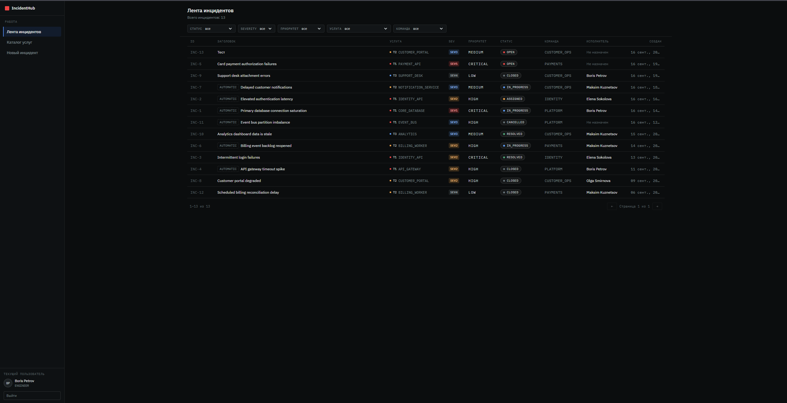
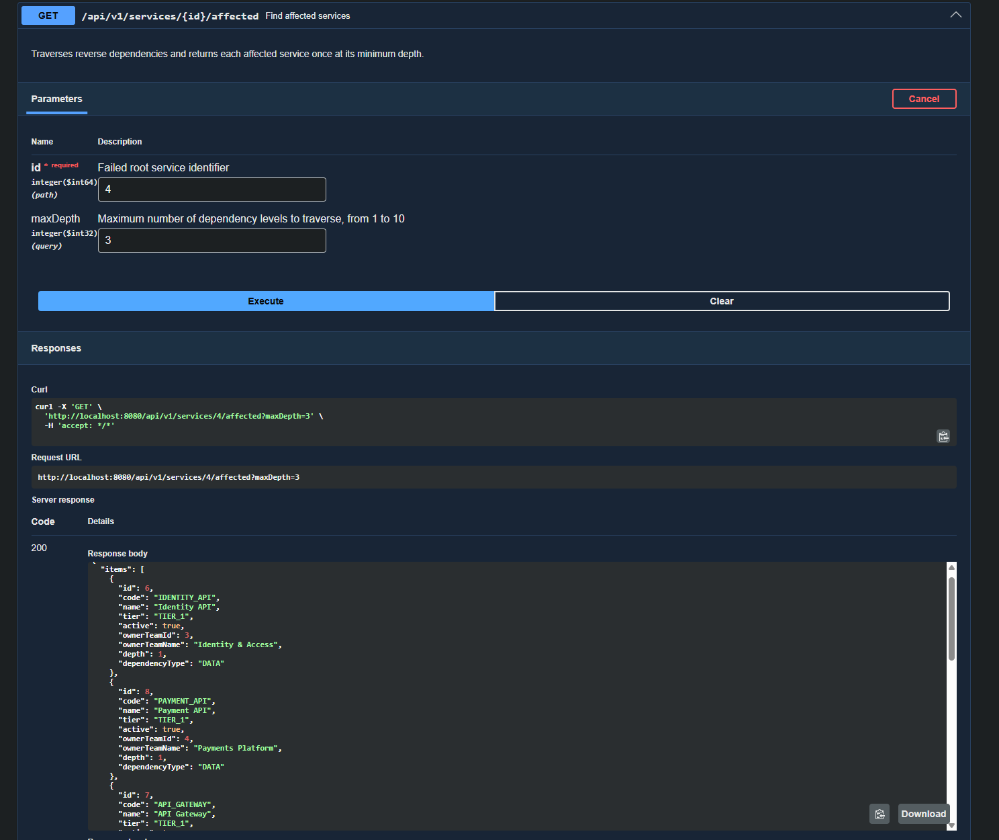
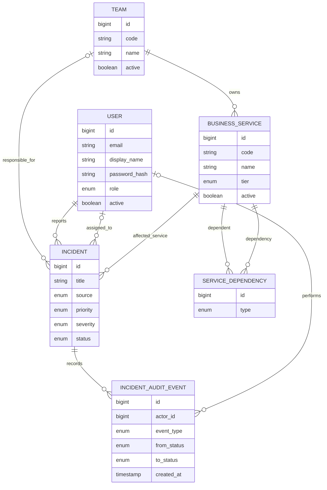

# IncidentHub

[](https://github.com/6yJlka/incident-hub/actions/workflows/ci.yml)

IncidentHub — полнофункциональное веб-приложение для регистрации и обработки внутренних технических инцидентов. Оно связывает инциденты с каталогом бизнес-услуг и помогает определить влияние сбоя по графу зависимостей.

Проект вдохновлён внутренней SRE-платформой Т-Банка [FineDog](https://www.tbank.ru/career/technologies/finedog/). Отсюда и главное архитектурное решение: центром модели является не заявка, а каталог услуг. Инцидент привязан к конкретной сломанной услуге, ответственная команда выводится из её владельца, а граф зависимостей отвечает на вопрос, кто ещё пострадает.

## Как запустить

Для запуска нужны Docker и Docker Compose. Скопируйте пример окружения и поднимите весь стек:

```bash
cp .env.example .env
docker compose up --build
```

В `.env.example` выбран профиль `demo`: он создаёт демонстрационные команды, пользователей, услуги, зависимости и инциденты. Без файла `.env` профиль можно передать прямо в командной строке:

```bash
SPRING_PROFILES_ACTIVE=demo docker compose up --build
```

В Windows PowerShell команда для демо-режима выглядит так:

```powershell
$env:SPRING_PROFILES_ACTIVE='demo'; docker compose up --build
```

Следующие учётные данные существуют только в демонстрационном режиме. Профиль `demo` включает локальные настройки JWT, а у всех активных демо-пользователей пароль `demo1234`:

| Роль | Email | Что можно показать |
|---|---|---|
| `REPORTER` | `anna.ivanova@incidenthub.demo` | Создание и чтение инцидентов; lifecycle-действия вернут 403 |
| `ENGINEER` | `boris.petrov@incidenthub.demo` | Назначение исполнителя и весь жизненный цикл инцидента |
| `ADMIN` | `olga.smirnova@incidenthub.demo` | Полный доступ, включая каталог, команды и создание пользователей |

Для пустой базы замените `SPRING_PROFILES_ACTIVE=demo` в `.env` на `SPRING_PROFILES_ACTIVE=local`. В этом режиме демонстрационные пользователи не создаются.

После запуска веб-интерфейс доступен на [http://localhost:3000](http://localhost:3000), REST API — на `http://localhost:8080`, Swagger UI — на [http://localhost:8080/swagger-ui.html](http://localhost:8080/swagger-ui.html). Порт фронта задаётся переменной `FRONTEND_PORT`. В compose браузер отправляет запросы на `/api` тому же nginx, который раздаёт интерфейс, а nginx проксирует их бэкенду внутри Docker-сети. При локальной разработке тот же путь проксирует Vite.

При первом старте Docker Compose соберёт бэкенд и фронтенд, запустит PostgreSQL и применит миграции Flyway. Остановить контейнеры можно командой `docker compose down`.

## Конфигурация

Вне профиля `local` приложение требует переменную `JWT_SECRET` с Base64-encoded секретом длиной не менее 256 бит. Известный локальный секрет из `.env.example` вне этого профиля отвергается при старте. Время жизни access-токена задаётся через `JWT_ACCESS_TOKEN_TTL` в формате `Duration`, по умолчанию `PT1H`.

`INTEGRATION_TOKEN` — отдельный статический токен мониторинга для приёма алертов. Вне профиля `local` он обязателен; известный локальный токен там запрещён. Профиль `demo` включает `local`. Токен передаётся в заголовке `X-Integration-Token` только на `POST /api/v1/alerts` и не даёт доступа к чтению API. `ALERT_MAX_BATCH_SIZE` ограничивает число элементов пачки, по умолчанию 500.

Разрешённые CORS-источники задаются через `CORS_ALLOWED_ORIGINS`; значение по умолчанию — `http://localhost:5173` для локальной разработки с Vite. В compose CORS не используется: браузер отправляет запросы на тот же origin, где nginx раздаёт интерфейс.

`VITE_API_BASE_URL` — build-time аргумент образа фронта. По умолчанию он пустой, поэтому используется описанная same-origin схема. Непустое значение нужно только при сборке фронта для размещения API на отдельном origin; изменение переменной после сборки не меняет уже созданные статические файлы.





## Что умеет IncidentHub

- Вести каталог бизнес-услуг, их владельцев, уровни критичности и направленные зависимости типов `SYNC`, `ASYNC` и `DATA`.
- Находить услуги, прямо или транзитивно затронутые сбоем, с ограничением глубины обхода и защитой от циклов. Если до услуги ведёт несколько путей, она возвращается один раз — на минимальной глубине.
- Регистрировать инциденты, назначать исполнителя и проводить инцидент по жизненному циклу `OPEN → ASSIGNED → IN_PROGRESS → RESOLVED → CLOSED`; поддерживаются повторное открытие и отмена.
- Хранить неизменяемую историю событий инцидента с автором каждого действия: создание, назначения и переходы между статусами.
- Регистрировать пользователей и выдавать JWT access-токены по email и паролю; закрытые API работают stateless и требуют Bearer-токен.
- Предоставлять REST API для работы с услугами, командами, пользователями и инцидентами. Интерактивное описание контрактов и выполнение запросов доступны через [Swagger UI](http://localhost:8080/swagger-ui.html), спецификация OpenAPI — по адресу [http://localhost:8080/v3/api-docs](http://localhost:8080/v3/api-docs).
- Работать с лентой и карточками инцидентов, каталогом услуг, каскадом влияния и жизненным циклом через веб-интерфейс с учётом роли пользователя.

Чтобы выполнить закрытый запрос в Swagger UI, зарегистрируйтесь через `POST /api/v1/auth/register`, войдите через `POST /api/v1/auth/login`, нажмите **Authorize** и вставьте полученный `accessToken`.

Публичная регистрация всегда создаёт пользователя с ролью `REPORTER`; роль не принимается из запроса. `POST /api/v1/users` доступен только `ADMIN` и создаёт полноценную учётную запись с обязательными паролем и ролью. Пароль сохраняется только как BCrypt-хеш и не возвращается из API.

| Операции | `REPORTER` | `ENGINEER` | `ADMIN` |
|---|:---:|:---:|:---:|
| Создание инцидента и чтение API | ✓ | ✓ | ✓ |
| Назначение, старт, устранение, закрытие, переоткрытие и отмена | — | ✓ | ✓ |
| Создание услуг, управление зависимостями и создание команд | — | — | ✓ |
| Создание пользователей с заданной ролью | — | — | ✓ |

Ошибки возвращаются в формате `application/problem+json` по RFC 9457, с собственными идентификаторами вида `urn:incident-hub:problem:not-found`. Недостаточная роль возвращает 403 с типом `urn:incident-hub:problem:access-denied`. При попытке выполнить недопустимый переход статуса ответ содержит текущий статус инцидента и список статусов, из которых переход разрешён.

## Тесты

```bash
./gradlew clean build

cd frontend
npm ci
npm run api:check
npm run lint
npm run test
npm run build
```

Из внешних зависимостей требуется только Docker: PostgreSQL для интеграционных тестов поднимается через Testcontainers автоматически, поднимать базу вручную не нужно.

Покрытие включает unit-тесты доменной модели и прикладных сценариев, интеграционные тесты репозиториев и миграций на реальной PostgreSQL, а также MVC-тесты контроллеров с проверкой кодов ответов и формата ошибок. Отдельно проверяется обход графа зависимостей: линейная цепочка, ромб с дедупликацией, цикл, ограничение глубины и несвязанные компоненты графа.

## Приём алертов

Мониторинг отправляет пачку в `POST /api/v1/alerts`; одиночный сигнал — пачка из одного элемента. Пользовательский JWT этот эндпоинт не открывает. Пример для локального демо-каталога:

```bash
curl -X POST http://localhost:8080/api/v1/alerts \
  -H "Content-Type: application/json" \
  -H "X-Integration-Token: $INTEGRATION_TOKEN" \
  -d '{"alerts":[{"source":"prometheus","externalId":"db-latency-123","serviceCode":"CORE_DATABASE","signalType":"LATENCY","severity":"WARNING","occurredAt":"2026-10-18T12:00:00Z","description":"Database p95 latency exceeds threshold"}]}'
```

В переменной `INTEGRATION_TOKEN` укажите токен из конфигурации сервера; для локального профиля по умолчанию это `incident-hub-local-integration-token`.

Ответ 200 содержит `results` в исходном порядке: `externalId`, `status` (`ACCEPTED`, `DUPLICATE`, `REJECTED`), `alertId` для принятых и дублей или `reason: UNKNOWN_SERVICE` / `OCCURRED_IN_FUTURE` для отклонённого элемента. Повтор определяется парой `(source, externalId)`; тело повтора игнорируется, в том числе при повторе внутри пачки. Разные источники могут прислать одинаковый `externalId`.

Неизвестная услуга отклоняет только свой элемент. Отсутствующие обязательные поля, неизвестные enum, пустая или слишком большая пачка дают 400 `ProblemDetail` на всю пачку, включая структурно невалидные повторы. Сигналы неизменяемы после приёма; корреляция и создание инцидентов в этот эндпоинт пока не входят.

Типы сигнала: `AVAILABILITY`, `ERROR_RATE`, `LATENCY`, `SATURATION`. Severity мониторинга — `CRITICAL`, `WARNING`, `INFO`; она независима от severity инцидента. Время `occurredAt` передаёт источник, `receivedAt` выставляет сервер.

`ALERT_MAX_CLOCK_SKEW` задаёт допустимое опережение часов источника (ISO-8601 duration, по умолчанию `PT1M`, неотрицательное; `PT0S` запрещает любое опережение). Значение `occurredAt <= receivedAt + допуск` принимается, превышение отклоняет только этот элемент с причиной `OCCURRED_IN_FUTURE`. Проверка дубля идёт раньше проверки времени: повтор уже принятого алерта остаётся `DUPLICATE` независимо от `occurredAt`. Отклонённый элемент не резервирует ключ: в одной пачке принимается первый допустимый элемент с этим ключом.

## Корреляция алертов

Вебхук только сохраняет сигналы. Отдельный фоновый обработчик выбирает непривязанные алерты по `occurredAt ASC, id ASC` и обрабатывает ограниченную пачку в одной транзакции. `pg_try_advisory_xact_lock` обеспечивает одного обработчика на базу среди всех экземпляров приложения; занятая блокировка означает пропуск тика. Ошибка откатывает всю пачку, повторный тик не меняет уже привязанные алерты.

Реализация `time-window` использует расстояние до интервала группы: внутри `[firstAlertAt, lastAlertAt]` оно равно нулю, снаружи — расстоянию до ближайшей границы. Алерт подходит, если это расстояние не превышает окно W. Выбирается ближайшая OPEN-группа, при равенстве — группа с меньшим ID. Если подходящей группы нет, создаётся новая OPEN-группа. Корень определяет коррелятор: это услуга самого раннего алерта; при равном времени сохраняется прежний корень.

Запоздавшие сигналы внутри интервала также присоединяются к группе, даже если далеко от её последнего алерта. Сигнал раньше начала группы, но в пределах W, расширяет интервал и меняет корень. **Ограничение baseline:** группы не сливаются, даже когда алерт подходит к окнам двух групп. Состояние OPEN не истекает автоматически; инженер подтверждает или отклоняет группу.

На тик загружаются только OPEN-группы, пересекающие временные границы пачки, расширенные на W. Их состав загружается одним запросом. Чистая функция `AlertCorrelator.correlate(CorrelationAlert, CorrelationContext)` получает неизменяемые снимки с составом групп, без доступа к БД и Spring. Baseline не использует граф зависимостей.

| Переменная | По умолчанию | Назначение |
|---|---|---|
| `ALERT_CORRELATION_ENABLED` | `true` | Включение фонового расписания |
| `ALERT_CORRELATION_INTERVAL` | `PT5S` | Пауза после окончания тика и до первого запуска |
| `ALERT_CORRELATION_BATCH_SIZE` | `500` | Максимум алертов за транзакцию |
| `ALERT_CORRELATION_IMPLEMENTATION` | `time-window` | Реализация коррелятора |
| `ALERT_CORRELATION_WINDOW` | `PT5M` | Ширина временного окна W |

Неположительные интервалы/размеры и неизвестная реализация запрещены при старте. При `enabled=false` расписание отключается.

Пользовательские JWT любой роли открывают `GET /api/v1/alert-groups` и `GET /api/v1/alert-groups/{id}`. Список поддерживает `page`, `size`, `status`, `rootServiceId` и сортируется по последнему алерту, затем ID, новые сверху. Карточка содержит алерты по времени возникновения и ID. Интеграционный заголовок на этих маршрутах игнорируется и без JWT доступа не даёт.

### Подтверждение и отклонение группы

`ENGINEER` и `ADMIN` могут принять решение только для OPEN-группы. Карточка возвращает `availableActions`: `CONFIRM`, `DISMISS` или пустой список с учётом роли и статуса. Пользовательский JWT передаётся в `Authorization`; токен интеграции эти действия не открывает.

```bash
curl -X POST http://localhost:8080/api/v1/alert-groups/1/confirm \
  -H "Authorization: Bearer $ACCESS_TOKEN" \
  -H "Content-Type: application/json" \
  -d '{"expectedVersion":0,"severity":"SEV2","priority":"HIGH"}'

curl -X POST http://localhost:8080/api/v1/alert-groups/2/dismiss \
  -H "Authorization: Bearer $ACCESS_TOKEN" \
  -H "Content-Type: application/json" \
  -d '{"expectedVersion":0,"reason":"Плановые работы"}'
```

Оба эндпоинта возвращают 200 с обновлённой карточкой. Для подтверждения `severity` и `priority` обязательны: их задаёт инженер независимо от severity сигналов. Необязательный `businessServiceId` заменяет вероятный корень при выборе услуги инцидента. `title` и `description` также необязательны: по умолчанию формируются из выбранной услуги и числа алертов.

Подтверждение в одной транзакции создаёт инцидент `AUTOMATIC` в статусе `OPEN`, назначает команду услуги, записывает аудит `CREATED` с подтверждающим инженером и связывает инцидент с группой. Карточка инцидента возвращает nullable `alertGroupId`. Отклонение не создаёт инцидент; тело запроса обязательно, причина необязательна и ограничена 2000 символами. В группе сохраняются `decidedById`, `decidedByDisplayName`, `decidedAt`, `dismissReason`. Алерты сохраняют связь с принятой группой; новые сигналы принимают только OPEN-группы.

Карточка группы возвращает `version`. Оба действия требуют неотрицательный `expectedVersion` из просмотренной карточки (в примерах `0` нужно заменить фактической версией). Проверка версии выполняется до проверки статуса: устаревшая версия после тика или чужого решения возвращает 409 `urn:incident-hub:problem:concurrent-modification`. Действие над закрытой группой с актуальной версией возвращает 409 `urn:incident-hub:problem:conflict`. Версия группы защищает одновременно решение инженера и пополнение коррелятором, даже когда временные границы не изменились. Проигравшая транзакция откатывается целиком, включая созданный инцидент и аудит. При конфликте версии фонового тика записывается одна строка WARN с ID группы без стектрейса; непривязанные алерты обрабатываются следующим тиком.

### Группы в интерфейсе

Раздел «Подозрения» (`/alert-groups`) показывает ленту с фильтрами статуса и вероятного корня, пагинацией и ссылками на созданные инциденты. Счётчик OPEN-групп в навигации использует `totalElements` списка с `status=OPEN`. В каждом элементе API списка есть `alertCount`, `serviceCount`, `servicePreviewCodes` (до трёх кодов по первому алерту, с разрешением совпадений времени по ID) и `worstSeverity` (`CRITICAL > WARNING > INFO`). Агрегаты выбираются одним запросом на страницу.

Карточка `/alert-groups/:id` открывает схему вероятного корня с переключением на подпись и таблицу алертов. «На пути отказа» — пересечение услуг группы с множеством `{корень + /services/{rootId}/affected?maxDepth=10}`; остальные услуги группы и их алерты помечаются «Вне пути». При ошибке загрузки зависимостей принадлежность пути не определяется. Это представление текущего каталога с ограничением глубины, а не новый метод корреляции.

В каждом элементе `/services/{id}/affected` добавлен `dependencies: [{serviceId, type}]`: все прямые зависимости внутри множества `{корень + affected}`, включая оба входящих ребра ромба. Один дополнительный запрос получает рёбра для всего множества; запросов карточек по узлам нет. Прежние поля, в том числе `depth` и `dependencyType`, сохранены для дерева инцидента.

Кнопки решений отображаются только по `availableActions`; REPORTER видит ожидание инженера. В подтверждении severity и priority выбираются отдельными группами кнопок, обязательны и изначально не выбраны. Ошибка подсвечивает конкретное поле, показывает сообщение под ним и переводит фокус на первое незаполненное поле; выбор поддерживает клавиатуру. Услуги группы идут перед остальным каталогом, заголовок и описание заполняются русскими шаблонами и отправляются явно. Максимальный сигнал группы показан как подсказка и не выбирает severity инцидента автоматически. Отклонение допускает пустую причину. Оба запроса передают просмотренный `expectedVersion`. После решения видны подписанные автор, время, причина либо ссылка на инцидент; обратная ссылка в инциденте расположена в метаданных шапки рядом с источником.

Severity сигнала во всех представлениях обозначена монохромными тремя делениями с подписью; цветовые SEV1–SEV4 относятся только к инциденту. Шапка группы показывает вероятный корень с tier-точкой и максимальный сигнал; боковая панель — число алертов, услуг, услуг на пути и вне пути, длительность. В схеме восемь чередующихся барицентрических проходов упорядочивают колонки. Каждое ребро занимает отдельную дорожку с шагом не менее 8px; промежутки между колонками и высота узлов расширяются по числу связей. Рёбра выходят справа и входят слева через разнесённые порты; стрелки направлены от зависимости к зависимому. Длинные, обратные и внутриколоночные связи обходят узлы сверху. Геометрические тесты проверяют отсутствие пересечений с посторонними узлами и слияния рёбер на демо-графе, широком слое, последовательных ромбах, длинном ребре и цикле.

Фонового опроса карточки нет. Ответ `concurrent-modification` показывает баннер «Группа изменилась» и блокирует решения до успешного ручного обновления. Ответ `conflict` сообщает о недоступном действии и перезапрашивает карточку.

## Архитектура

Приложение построено как модульный монолит: оно разворачивается одним процессом и использует одну базу PostgreSQL, а код разделён по бизнес-областям. Такое устройство сохраняет простую эксплуатацию монолита и задаёт явные границы ответственности между частями системы.

| Домен | Ответственность |
|---|---|
| `catalog` | Каталог бизнес-услуг, граф зависимостей и расчёт затронутых услуг |
| `incident` | Регистрация инцидентов, поиск, назначение и жизненный цикл |
| `audit` | Неизменяемая история доменных событий инцидента |
| `team` | Команды-владельцы услуг и ответственные команды |
| `identity` | Пользователи, авторы и исполнители инцидентов |
| `auth` | Регистрация пользователей и проверка учётных данных |
| `security` | Stateless-защита HTTP API, выпуск и проверка JWT |
| `common` | Общая конфигурация API и обработка ошибок |

Внутри доменов код разделён на доменную модель, прикладные сценарии, HTTP-слой и инфраструктуру хранения. Границы выбраны по бизнес-ответственности: каталог отвечает на вопрос о влиянии сбоя, модуль инцидентов управляет работой над ним, а аудит фиксирует произошедшие изменения.

Правила жизненного цикла инкапсулированы в самой сущности инцидента: допустимость перехода проверяет доменная модель, а не прикладной сценарий. Аудит записывается в той же транзакции, что и изменение статуса.

## Стек

| Технология | Версия и назначение |
|---|---|
| Java | 21 |
| Spring Boot | 4.0.7; Web MVC, Data JPA, Validation, Security, Actuator |
| PostgreSQL | 16 Alpine |
| JJWT | 0.13.0; выпуск и проверка JWT |
| springdoc-openapi | 3.0.1; OpenAPI и Swagger UI |
| Gradle | 9.5.1 через Gradle Wrapper |
| Flyway, Hibernate, JUnit | Версии управляются BOM Spring Boot 4.0.7 |
| Testcontainers | Интеграционные тесты с `postgres:16-alpine` |
| React, TypeScript, Vite | Веб-интерфейс и клиентская маршрутизация |
| nginx | Раздача статики, SPA fallback и same-origin прокси для `/api` |
| Docker Compose | Локальный запуск фронта, приложения и базы данных |

## Доменная модель



Зависимость направлена от `dependent` к `dependency`: если недоступна `dependency`, затронутой считается услуга `dependent` и все зависящие от неё услуги. Каждый инцидент относится к одной затронутой услуге, имеет автора и может иметь ответственную команду и назначенного исполнителя. Новые записи аудита всегда получают автора из JWT. У старых записей, созданных до появления этого поля, автор может отсутствовать.

Критичность и приоритет разведены намеренно: `severity` (`SEV1`–`SEV4`) описывает влияние на бизнес, `priority` — очерёдность работы над инцидентом.

## В планах

- Публичный деплой.
- Текстовая хроника инцидентов.
- Приём событий мониторинга.
- Группировка связанных инцидентов.
- Подписки и эскалации.
- SLA.
- Постмортемы.
- Аналитика.
